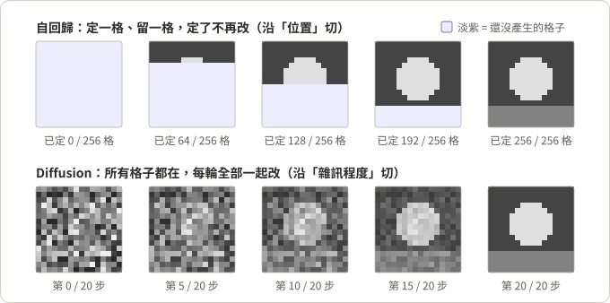
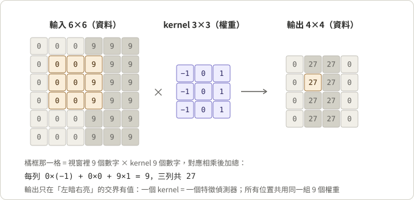
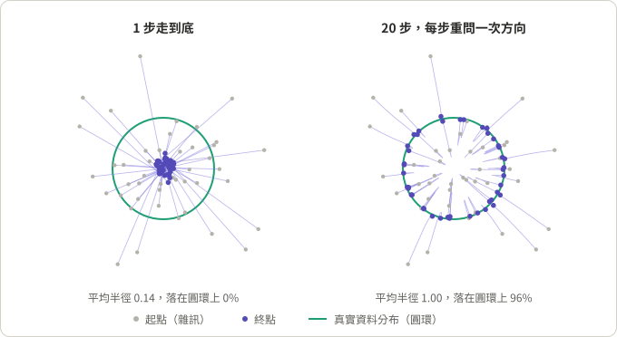
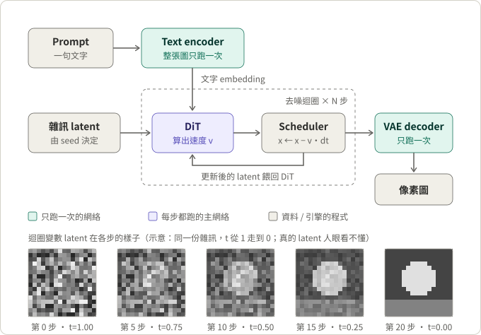
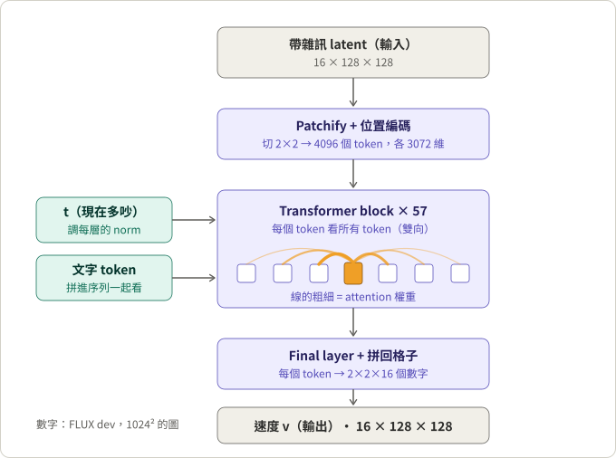
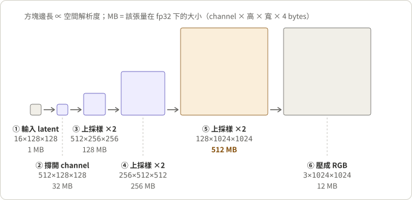

# 03 — 模型種類、引擎歸屬與應用層編排（從 TRELLIS.2 挖出來的一條線）

- 學習方式：從「TRELLIS.2 是什麼」挖到「模型 vs 引擎」「引擎裡裝什麼」「自回歸 vs diffusion」「UNet vs DiT」「latent」「多引擎編排」
- 第二輪強化：從「圖片到底是怎麼生成的」往下挖到「生成 = 抽樣」「速度場」「VAE decoder」「卷積 vs attention」「架構 × 生成方式」「權重 vs 資料」「logits vs 速度」。新增第 7、9 章；第 0、1、3–6、8、11、12 章、思維鏈、陷阱清單、心智模型補強；圖放在 `img/`
- 目前定位：🥚 概念（路線圖已走過一遍，尚未動手部署）；第二輪強化時已在 🐣 本機驗證與第一次 LoRA POC 之後，這一輪純概念，沒有動手產圖
- 時效標記：模型名稱、授權、工具行為標「2026-10 時」，第二輪新增的標「2026-11 時」；設計原理不標

---

## 0. 一句話版本

**需要 GPU 只代表它是神經網絡；是哪一種模型看「輸入→輸出 × 生成方式」；引擎的大部分程式碼是外層迴圈而非 transformer block，所以引擎跟著生成方式走；不同引擎之間只能在應用層用 HTTP 串，LLM 本身只會吐文字。**

**生成一張圖 = 從「所有合理圖片的機率分布」抽一個點；diffusion 主網絡的權重存的是一張速度場而不是圖片，引擎沿著它把雜訊一小步一小步搬成 latent，再由卷積做的 VAE decoder 一次放大成像素。**

---

## 1. 分層模型（骨架）

```
應用層     Open WebUI / 自寫 orchestrator / MCP     ← 對話 DB 在這、路由決定在這、多引擎串接在這
引擎       Ollama / vLLM（自回歸）                   ← 常駐 process、握權重、聽 port、排請求
           ComfyUI（diffusion）
           自帶 pipeline（研究 repo，如 TRELLIS.2）
模型       權重 + 架構定義（HF 上的 safetensors / GGUF）← 只有數字，沒有「怎麼算」的程式碼
訓練       PEFT / LLaMA-Factory（LLM）、kohya / ai-toolkit（diffusion LoRA）
GPU        矩陣乘法；LLM 頻寬瓶頸、diffusion 算力瓶頸
```

**兩條獨立的分類軸，不要疊在一起：**

| 軸 | 回答什麼 | Llama 3.1 vs TRELLIS.2 |
|---|---|---|
| 堆疊層次 | 它在系統的哪一層 | **同層**（都是模型層） |
| 模型種類 | 輸入→輸出 + 生成方式 | **不同種**（文字→文字 自回歸 vs 圖→3D diffusion） |

引擎選擇看模型種類，不看層次。

**模型層內部再分三層，由外到內是包含關係：**

```
生成方式（外層迴圈怎麼跑）            自回歸 | diffusion                      ← 引擎實作這一圈
  └─ 元件（各有一份權重、一張計算圖）  text encoder / 主網絡 / 圖片 decoder
       └─ 積木（元件裡的運算）        attention / 卷積 / 線性層 / norm
```

「VAE decoder」是元件，「attention」是積木，不在同一層，不是二選一（就像不會問「要用 PostgreSQL 還是 B-tree」）。「DiT」是用 attention 這種積木蓋出來的主網絡。積木跟著每個元件的工作量和任務選，不是跟著生成方式選（第 5 章）。

---

## 2. 模型 vs 引擎：權重沒有說明書，引擎裡裝什麼

**核心規則**：權重檔只有一堆有名字的矩陣。「哪個矩陣在什麼時候乘誰」的程式碼在引擎裡。

**引擎的四塊**（以 llama.cpp / Ollama 為例）

```
① 權重載入     讀 GGUF，按 tensor 名字（blk.0.attn_q.weight、blk.0.ffn_up.weight…）放進記憶體 ← 名字對照表
② forward graph 手寫的「這個架構第 N 層怎麼算」：attn_q 乘 x → RoPE → causal attention → 殘差 → RMSNorm → ffn…
③ 外層迴圈     tokenize → prefill → while not EOS: forward 1 token → 讀 KV cache → sample → append
④ I/O         tokenizer、chat template、streaming HTTP、OpenAI 相容 API
```

**transformer block 只是 ② 裡的一小段**；引擎大部分程式碼在 ①③④。「架構相同」指 ② 那一小段的算術相同，不代表引擎能跑。

**DiT 進 Ollama 四層全擋**

| 層 | 為什麼擋 |
|---|---|
| ① | tensor 名字是 `double_blocks.0.img_attn.qkv.weight`、`time_in.in_layer.weight`，對照表裡沒有 |
| ② | graph 是 causal + RoPE + 一次一 token；DiT 要雙向 + adaLN + 4096 patch 同時進 |
| ③ | 迴圈條件「吐到 EOS」，DiT 不吐 token |
| ④ | 沒有 VAE，輸出不可能變成圖 |

**轉成 GGUF 也一樣跑不了**——檔案格式 ≠ 架構 ≠ 精度。

**比喻**：PostgreSQL 和 Redis 共用同一套 C 標準庫（malloc、socket、hash table），你不會期待 Redis 能跑 SQL。共用的是積木函式，不同的是誰在什麼時候以什麼順序呼叫。SQLite 開不了 PostgreSQL 的檔 = Ollama 跑不了 DiT。

**引擎為什麼不做成通用的**：引擎的價值是針對一種「外層迴圈的瓶頸」榨到極限。vLLM 的 PagedAttention / continuous batching 全建立在「有 KV cache、每輪算量小、請求長度不定」上，DiT 沒有這些，優化無處施力。

**研究型 repo（TRELLIS.2）** 把「模型」和「跑模型的程式」綁在一起發布，看起來像 kit，其實是「專用引擎 + 權重」兩層。

---

## 3. 模型種類：輸入→輸出 × 生成方式

| 輸入 → 輸出 | 俗稱 | 例子 | 生成方式 | 引擎 |
|---|---|---|---|---|
| 文字 → 文字 | LLM | Llama、Qwen | 自回歸 | Ollama、vLLM、llama.cpp |
| 文字+圖 → 文字 | VLM | Qwen-VL、Llama 3.2 Vision | 自回歸 | Ollama、vLLM |
| 文字 → 向量 | embedding model | bge、nomic-embed | 一次 forward | Ollama、vLLM |
| 文字 → 圖 | 圖像生成 | FLUX、SD、Qwen-Image | diffusion | ComfyUI、diffusers |
| 圖 → 3D mesh | 3D 生成 | TRELLIS.2 | diffusion | 自帶 pipeline |
| 語音 → 文字 | ASR | Whisper | 自回歸 | whisper.cpp |

**引擎跟著「生成方式 + 架構」走**：自回歸文字一族共用 Ollama / vLLM；diffusion 一族共用 ComfyUI；研究型 3D 什麼都共用不了。本專案路線只用前三列，**一套引擎（Ollama → vLLM）走完**。

### 「AI 產出一張圖」的三條路：像素是誰決定的

| 路線 | 模型吐什麼 | 誰決定像素 | 例子（2026-11 時） |
|---|---|---|---|
| 寫程式給 renderer 畫 | 文字 token（SVG / HTML / 繪圖程式碼） | 瀏覽器的 rasterizer 或繪圖函式庫（傳統程式，不是神經網絡） | 只有文字輸出的 LLM。Claude 屬於這種：官方文件寫明輸出只有文字、不能生成圖片 |
| diffusion / flow | 整張 latent，反覆修 | 去噪網絡 + VAE decoder | FLUX、SD、Qwen-Image |
| 自回歸圖片 token | 一格一格的圖片 token | 主網絡 + 圖片 decoder | GPT-4o 原生產圖（OpenAI 稱 autoregressive，細節未公開）、Janus |

- 第一條路畫得出精確的圖表、版面、icon，畫不出照片質感：它在**描述形狀**，不是在決定每個像素
- 純文字 LLM 的產品裡看到的圖有三種來源：吐 SVG / HTML 給瀏覽器畫；寫繪圖程式（如 matplotlib）在沙盒裡跑出 PNG；透過 tool call 把 prompt 字串交給**別的**產圖模型（第 12 章做法 A）。三種都沒有經過它自己的去噪網絡或 VAE decoder，因為它沒有

---

## 4. 自回歸 vs Diffusion：外層迴圈的差異

**自回歸 = Autoregressive（AR）**：auto（自己）+ regressive（回歸），用自己過去的值預測下一個。

```
p(x₁…xₙ) = p(x₁) · p(x₂|x₁) · p(x₃|x₁,x₂) · … · p(xₙ|x₁…xₙ₋₁)
```

**共同起點**：兩者做的是同一件事，從「所有合理輸出的機率分布」抽一個樣本。這個分布寫不出公式，所以都把一個做不到的大問題切成很多做得到的小問題，差別在**沿哪個方向切**。

| | 自回歸 | Diffusion |
|---|---|---|
| 切法 | 沿「位置」切：第 1 格是什麼 → 給定前面，第 2 格是什麼 → … | 沿「雜訊程度」切：很吵時全圖大概往哪走 → 稍微不吵時往哪走 → … |
| 每個小問題 | 從有限個候選裡選一個（選擇題） | 所有數字一起移一小步（微調題） |

**根本差異（只有這一條，後面全是它的後果）**

- 自回歸：一次決定**一個位置**，決定後**永不再改**
- Diffusion：**所有位置一開始就都在**（全是雜訊），每輪**全部一起改**

```
自回歸（寫 5 個字，5 輪）        Diffusion（4096 格，20 輪）
輪1  今                          輪1   ▓▓▓▓▓▓  全雜訊
輪2  今天                        輪5   ▒▒▒▒▒▒  隱約輪廓
輪3  今天天                      輪12  ░░░░░░  大致成形
輪4  今天天氣                    輪20  ██████  定稿
輪5  今天天氣好 <EOS>
```

同一張圖在兩種切法下，迴圈變數各自怎麼演進：



**兩種迴圈並排**

```python
# ===== Ollama / vLLM：自回歸迴圈 =====
ids = tokenizer(prompt)                        # CPU
kv = prefill(ids)                              # GPU，一次算完 prompt，填 KV cache
while True:
    logits = forward(ids[-1], kv)              # GPU，只算 1 個新 token，讀整份權重 + KV
    kv.append(k_new, v_new)                    # KV cache 長 1
    tok = sample(logits, temperature)          # CPU，從分布抽一個
    ids.append(tok); stream(decode(tok))       # 立刻吐
    if tok == EOS: break                       # 步數由模型決定

# ===== ComfyUI：去噪迴圈 =====
cond = text_encoder(prompt)                    # GPU，一次
x = randn(1, 16, 128, 128) * sigma[0]          # CPU，隨機雜訊 latent（1024² 的圖），形狀固定
for t in range(N):                             # 步數由設定決定（4 / 20 / 30）
    eps = dit(x, t, cond)                      # GPU，整個 latent 全進，雙向 attention，無 cache
    eps_u = dit(x, t, cond=None)               # CFG 開時再算一次
    eps = eps_u + cfg * (eps - eps_u)
    x = scheduler.step(x, eps, sigma[t])       # CPU，x 被整個覆寫
image = vae.decode(x)                          # GPU，一次
```

去噪迴圈這段用的是「預測雜訊 eps」的寫法。flow matching 模型（FLUX、SD3）把 eps 換成速度 v、更新式換成 `x = x − v·dt`，迴圈形狀完全相同（第 7 章）。

### 推論鏈 1：形狀與終止

| | 自回歸 | Diffusion | 為什麼 |
|---|---|---|---|
| 迴圈變數 | 序列（每輪多一格） | latent（形狀固定，內容整個覆寫） | 根本差異本身 |
| 終止 | 模型吐 EOS | 設定的 N | 長度未知只能等模型喊停 vs 格數已知，只剩「修幾次」 |
| 可串流 | 可（前半句已定） | 不可（每處都還會變） | 定了不改才能先吐 |
| 隨機性 | 每輪 sample | 主要在 t=0 初始雜訊 | 每定一格抽一次 vs 起點抽一次後照著算（ancestral / SDE 類 sampler 每步會再加雜訊） |

### 推論鏈 2：舊的計算能不能留（KV cache 的來源）

| | 自回歸 | Diffusion | 為什麼 |
|---|---|---|---|
| 跨輪狀態 | KV cache | 無 | 前面 token 不變 → hidden state 不變 → 可存；latent 整個變 → hidden state 全作廢 |
| 每輪 forward 輸入 | 1 個新 token + 舊 KV | 整個 latent，全部重算 | 有 cache 只算新的；沒 cache 只能全算 |
| attention mask | causal | 無（雙向） | 後面的字還不存在，且前面的結果若受後面影響 cache 就不成立；diffusion 所有格都在，互看才能協調 |
| 條件進入 | 就是序列前段 | 每輪重新注入（adaLN / joint attention） | prompt 進了 KV cache 就一直在；diffusion 每輪是全新 forward，沒有東西記得 prompt |

### 推論鏈 3：GPU 瓶頸（引擎長得不一樣的原因）

| | 自回歸 | Diffusion | 為什麼 |
|---|---|---|---|
| 每輪 GPU 工作量 | 小 → **頻寬瓶頸** | 大 → **算力瓶頸** | 每吐 1 token 要讀過整份權重卻只算 1 token，時間花在搬權重；diffusion 每輪 4096 格都要算，算術本身塞滿 GPU |
| 多請求合併 | 能：多人的「下一 token」疊成 batch 共讀一次權重 | 單張已塞滿 GPU，疊了只是等更久 → FIFO | 瓶頸是讀權重時，多算幾個 token 幾乎免費；瓶頸是算術時，疊了沒有便宜 |
| 優化手段 | PagedAttention、continuous batching | torch.compile、flash-attn、fp8、蒸餾減步數、多卡切 patch | 把更多人塞進同一次讀取 vs 讓每次算術更快或減少輪數 |

### 推論鏈 4：主網絡每輪吐什麼（機率表 vs 點估計）

| | 自回歸 | Diffusion | 為什麼 |
|---|---|---|---|
| 主網絡輸出 | logits：下一格對每個候選的分數，一張機率表 | 速度（或雜訊預測）：跟 latent 同形狀的一個點估計 | 選擇題可以列出每個選項的機率；連續微調題只能給一個方向 |
| 資料型態 | 必須離散（候選有限才列得出機率表），且要有先後順序 | 連續數值，不需要順序 | 文字天生離散有序；圖片兩樣都沒有 |
| 「不確定」怎麼表達 | 如實寫成機率（紅 50%、藍 50%），再抽一個 | 寫不出來，只能輸出平均（紅藍平均成紫）→ 不能一步到位（第 7 章） | 機率表 vs 點估計 |
| 能不能反悔 | 不能，前面定錯只能圓回來 | 能，每輪全圖覆寫 | 根本差異本身 |

logits 和速度的具體長相見第 9 章。

**圖片要走自回歸，得補兩個人為設計**（文字天生離散有序，不用補）

| 元件 | Diffusion 路線 | 自回歸路線 |
|---|---|---|
| 圖 ↔ 模型的資料 | VAE：每格 16 個連續數字 | VQ tokenizer：每格換成碼本（codebook）裡的一個編號 |
| 順序 | 不需要 | 人為規定，最常見是由左到右、由上到下 |
| 主網絡 | DiT：雙向、吐速度 | causal Transformer：吐 logits（跟 LLM 同一種積木） |
| 迴圈的另一半 | scheduler：`x ← x − v·dt` | sampler：抽一個編號，接到序列尾端 |
| 最後一步 | VAE decoder | VQ decoder（一樣是卷積放大器） |

```
1024² 的圖（假設壓 16 倍 → 64×64 格）
自回歸   ：4096 次 forward，每次只算 1 個新 token（有 KV cache） → 次數多、每次輕
Diffusion：20–40 次 forward，每次算全部 4096 個 token             → 次數少、每次重
```

各自的弱點：自回歸產圖的順序是硬加的，畫到右下角才發現左上角構圖不對也改不了，離散化也會丟細節；diffusion 每輪都重、不能串流、不輸出機率。2026-11 時開放權重的產圖主流仍是 diffusion / flow。

**一句話**：自回歸「定一格、留一格」→ 有 cache、每輪輕、能串流、能合併多人；diffusion「全部一起反覆修」→ 無 cache、每輪重、不能串流、只能排隊。

**比喻**：自回歸 = 寫作文，一字一字往下寫，錯了只能圓回來；diffusion = 畫油畫，先打底再逐層細化，每層可蓋掉上一層。**不是「收斂 vs 發散」**，兩者都收斂到一個樣本；差在生成的順序與範圍。

ComfyUI 的「引擎」本質 = PyTorch + DAG executor + 一條佇列。不需要也沒有 vLLM 那種調度器。

---

## 5. 積木：CNN / UNet vs Transformer / DiT（架構軸）

**核心規則**：積木（卷積、attention）是運算；架構（UNet、Transformer）是積木怎麼疊；生成方式（自回歸、diffusion）是外層迴圈。**生成方式只規定主網絡的簽名（吃什麼、吐什麼），不規定裡面用什麼積木。**

```
diffusion 的要求：f(帶雜訊 latent, t, 條件) → 同形狀的速度（或雜訊預測）
自回歸的要求  ：f(前面所有 token)         → 下一個 token 的機率表，且不能偷看後面
```

任何滿足簽名的網絡都能塞進去。檢驗方法：把 DiT 抽掉換成 UNet，外層迴圈一行都不用改，它還是 diffusion。所以 attention 是 DiT 帶來的，不是 diffusion 帶來的。

**名字在講哪一層**

| 名字 | 在講什麼 | 有沒有講用在哪種生成方式 |
|---|---|---|
| Transformer | 架構家族：attention + MLP 疊很多層 | 沒有 |
| UNet | 另一種架構的形狀：卷積為主，先縮小再放大，中間有跳接 | 沒有 |
| DiT | Transformer **用在 diffusion** 時的名字（Diffusion Transformer） | 有，名字裡就帶了 |

```
架構家族（積木怎麼疊）
├─ Transformer（attention 為主）
│    ├─ 用在自回歸   → LLM / VLM 的主網絡（加 causal mask）
│    └─ 用在 diffusion → DiT（FLUX、SD3；文字和圖 token 拼在一起做 attention 的變體叫 MMDiT）
└─ 卷積網絡
     ├─ 用在 diffusion → UNet 形狀（SD 1.5、SDXL；中間也混了 attention 層）
     ├─ 用在自回歸   → PixelCNN、WaveNet（古早，現在少見）
     └─ 用在圖片 decoder → VAE decoder
```

Transformer 是材料；DiT 是用這個材料蓋的、專門放進 diffusion 迴圈的那一款；UNet 是用另一種材料蓋的、放在同一個位置的舊款。一個元件可以同時用兩種積木（SDXL 的 UNet、VAE decoder 中間那層小 attention）。

**2×2 表**

| | 自回歸 | Diffusion |
|---|---|---|
| **Transformer** | LLM / VLM：字 token、causal、有 KV cache | **DiT**：patch token、雙向、無 KV cache、adaLN 進條件 |
| **CNN / UNet** | —（PixelCNN，古早） | SD 1.5 / SDXL：濾鏡滑動、U 形、skip 保細節 |

- LLM 和 FLUX：同行不同列 → 共用積木，不共用引擎
- SD 1.5 和 FLUX：同列不同行 → **ComfyUI 都能跑**（引擎認的是列）
- 角落：diffusion LLM（2026 時：LLaDA、Mercury）——文字 + diffusion。證明「LLM」綁的是資料+任務，不是生成方式
- **設計時**四格自由組合；**訓練後**一份權重固定在其中一格。輸入層、輸出層、mask、訓練目標都不同，訓練好的 DiT 權重不能拿去跑自回歸迴圈，LLM 的權重也不能拿去跑去噪迴圈
- 兩邊在 2026 年都選 attention 是工程上的勝出（一層就能跨全場、加大模型效果持續變好），不是定義上的必然

### 卷積（convolution）與 CNN（Convolutional Neural Network）
- 核心規則：一個小的權重方塊（kernel，常見 3×3）蓋在格子資料的每個位置上，對應相乘再加總，每個位置得到輸出的一格
- 誰持有：kernel 是權重，存在檔案裡，訓練出來的；輸入和輸出都是資料
- 誰執行：GPU，所有位置同時算。「滑動」只是幫助理解的說法，沒有一個 CPU 迴圈在一格一格移
- 設計理由：權重共用（整張圖每個位置用同一組 kernel → 參數量與圖大小無關）、局部性先驗（相鄰像素相關）
- 代價：視野局部，一格只看得到鄰居，看全圖得堆很深



```
真實的 kernel 是 3×3×輸入 channel 數，而且有「輸出 channel 數」個
VAE decoder 裡一層典型卷積（512 channel 進、512 出）：512 × 512 × 3 × 3 ≈ 236 萬參數
這個數字在 64×64 和 1024×1024 的圖上一樣 → 權重小；吃 VRAM 的是每層的輸出（activation），見第 8 章
連疊 n 層 3×3，一格看到的範圍是 (2n+1)×(2n+1)：3 層看 7×7；正中央一格要看到整張 128×128 得疊約 64 層
→ UNet「先縮小再放大」就是為了讓卷積不用疊那麼深也看得夠遠
```

```python
# M1 / Linux 相同，CPU 就夠
import torch, torch.nn.functional as F
x = torch.tensor([[0,0,0,9,9,9]] * 6, dtype=torch.float32).view(1, 1, 6, 6)    # 輸入：batch=1, channel=1, 6×6
k = torch.tensor([[-1,0,1]] * 3, dtype=torch.float32).view(1, 1, 3, 3)         # kernel：1 個輸出 channel, 1 個輸入 channel, 3×3
print(F.conv2d(x, k)[0, 0])              # 每列都是 [0, 27, 27, 0]，形狀 4×4
print(F.conv2d(x, k, padding=1).shape)   # 四周補 0 → 輸出維持 6×6
```

### attention：依內容現算的搬運
- 核心規則：每個 token 對所有 token 發問，依相關度算出一組權重，再把別人的資訊按權重**搬過來**加到自己身上。問誰、搬多少，是每次看內容現算的
- 「理解語意」是它的效果，不是它做的動作。「bank」從「river」那裡搬到資訊，於是變成「河岸」的意思。機制裡沒有任何一步是專為文字設計的，所以 token 換成圖片 patch 一樣能用

```
t   | CPU/GPU | 一層 attention 裡發生什麼（所有 token 同時做）
t0  | GPU     | 每個 token 用權重矩陣算出三個向量：query（我在找什麼）、key（我是什麼）、value（我能給什麼）
t1  | GPU     | 每個 token 的 query 跟所有 token 的 key 做內積，得到一排分數
t2  | GPU     | softmax 把分數變成加總為 1 的權重
t3  | GPU     | 用這排權重把所有 token 的 value 加權平均
t4  | GPU     | 結果加回自己身上，進下一層
```

**在圖片裡它搬什麼**（token = patch，FLUX 在 1024² 時是 4096 個）

| 用途 | 誰問誰 | 例子 |
|---|---|---|
| 消歧義 | 帶雜訊的 patch 問周圍和遠處的 patch | 單看這塊雜訊可能是天空也可能是水面；看到上方有太陽、下方有船，就定成水面。跟「bank」靠「river」定意思是同一件事 |
| 全局一致 | patch 問很遠的 patch | 左眼右眼顏色一致、影子方向跟光源一致、倒影跟本體一致 |
| 文字綁定 | 圖 patch 問文字 token | 「紅色方塊和藍色球」：方塊的 patch 從「紅色」搬資訊，球的 patch 從「藍色」搬；綁錯就是常見的顏色互換 |

第三項是 prompt 進入圖片的實際通道：FLUX 把文字 token（最多 512 個）跟 4096 個 patch 拼成同一條序列，每層約 (4096+512)² ≈ 2100 萬對。跟 LLM 的 attention 機制相同，只有三處設定不同：沒有 causal mask、位置編碼是二維的、每步重算所以沒有 KV cache。

### 卷積 vs attention

| | 卷積 | attention |
|---|---|---|
| 一層能搬多遠 | 鄰居（疊很多層才慢慢變遠） | 任意遠，第一層就看到全部 |
| 搬誰、搬多少 | 訓練完固定，跟內容無關 | 每次依內容現算 |
| 擅長 | 邊緣、紋理這類「到處都一樣」的局部規律 | 「這裡該畫什麼取決於那裡畫了什麼」的關係 |
| 成本 | 跟位置數成正比 | 跟位置數的平方成正比 |
| 1024² 像素（約 10⁶ 個位置） | 10⁶ × 固定小工作量，做得動 | 10⁶ × 10⁶ = 10¹² 對，做不了 |

比喻（誰持有、誰觸發）：卷積 = 會場裡每個人只能跟鄰座交談，問的是事先印好的同一張問卷（kernel 是固定權重），消息要傳到會場另一頭得一層一層接力；attention = 每個人可以對全場發問，問題依自己現在的狀況現編（query 從內容算出來），誰的回答相關就多聽誰的，一層就跨全場。

**分工**：關係用 attention 在幾千個 token 的小 latent 上解決（主網絡定構圖、綁文字）；紋理用卷積在百萬像素上解決（VAE decoder 補細節）。

### UNet
- CNN 的一種形狀：左半壓縮（抓語意）→ 瓶頸 → 右半放大（還原細節），**skip connection** 把同解析度特徵直接接過去
- 用在 diffusion 的理由：去噪任務「輸入帶雜訊 latent，輸出同形狀雜訊預測」，**輸入輸出同形狀**正是 UNet 的設計目的

### DiT（Diffusion Transformer，2023）
- 做法：把 UNet 整個換成 transformer，其他不動
- 圖怎麼變 token：latent 128×128×4 → 切 2×2 patch → 4096 個 → 線性投影成向量 → 加位置編碼 → N 層 → 投影回 → 拼回 128×128×4（FLUX 的 latent 是 128×128×16，每個 patch 是 2×2×16 = 64 個數字，投影成 3072 維；一次 forward 的完整圖在第 8 章）
- 條件怎麼進：**adaLN**（timestep + 文字 embedding → 縮放/平移係數調 LayerNorm）或 **MMDiT**（SD3 / FLUX：文字 token 和圖 token 拼在一起做 attention）

| | LLM block | DiT block |
|---|---|---|
| attention | causal | 雙向 |
| 條件 | 就是 prompt token | adaLN 或 MMDiT 拼接 |
| 輸出 | 下一 token 分布 | 每個 patch 的速度 / 雜訊向量 |
| KV cache | 有 | 無 |

**為什麼 DiT 取代 UNet**：全局視野第一層就看全圖；scaling 不飽和（UNet 加大到某程度就平）；不要求格子資料（稀疏體素、影片、任意長寬比）；MMDiT 讓文字和圖在同一個 attention 裡對應，文字渲染大幅改善。

---

## 6. Latent：VAE 壓縮後的圖（名詞，不是動作）

**核心規則**：latent 是**被餵進 DiT 的那個 tensor**，不是「每步重算」這個動作。它是資料，不是權重。

| 用法 | 指什麼 |
|---|---|
| latent（名詞，本章用這個意思） | 那個張量本身（FLUX、1024² 的圖：16×128×128） |
| latent space | 所有可能的這種張量構成的空間，座標軸的意義由 VAE 定義 |
| 字面 | 「潛在、隱藏」：人眼看不懂，要過 decoder 才看得到 |

```
像素空間（人看得懂）         latent 空間（模型工作的地方）
1024 × 1024 × 3 (RGB)   ──VAE encoder──▶   128 × 128 × 4
= 3,145,728 個數字         ◀──VAE decoder──   = 65,536 個數字（SD，壓 48 倍）
```

直接看 latent 是一片彩色雜訊；每個位置對應原圖一塊 8×8，4 個 channel 編碼那塊的「內容」。VAE 是**學出來的壓縮器**（JPEG 是人寫死的 DCT），學出來的空間有一個性質：**相近的點解碼出相似的圖**，去噪網絡才能在裡面「慢慢走向合理的圖」。

它仍然是一張格子圖：latent 左上角那一格對應原圖左上角 8×8 像素。那一塊原本是 8×8×3 = 192 個數字，SD 摘要成 4 個（壓 48 倍），FLUX 摘要成 16 個（壓 12 倍）。這些數字不是顏色，是 VAE 自己學出來的編碼，大意是「這塊是什麼邊緣、什麼紋理、什麼色調」。比喻：像素 = 印出來的照片，latent = 那張照片的 JPEG 檔內容（一串要 decoder 才能看的數字）。跟 JPEG 的兩個差別：編碼規則是學的；latent 保留空間格子，所以 DiT 還能切 patch、加位置編碼。

**誰產生、誰持有、誰觸發**

| 時機 | latent 從哪來 | 誰用它 |
|---|---|---|
| 訓練 | 真圖 → VAE encoder → latent → 加雜訊 | DiT 學「從帶雜訊 latent 預測雜訊」 |
| 推理 t=0 | 純隨機數，形狀固定（**沒經過 encoder**） | sampler |
| 推理每步 | 上一步 latent 減一部分雜訊 | DiT 讀、scheduler 寫回 |
| 推理結束 | 乾淨 latent → VAE decoder → 像素 | 使用者 |

text-to-image **從頭到尾 VAE encoder 沒出場**；encoder 只在訓練和 img2img（把使用者的圖壓進去當起點）用。

**數字**

```
SD 1.5 / SDXL     f8  c4    1024² → 128×128×4   = 65,536    壓 48×
FLUX / SD3        f8  c16   1024² → 128×128×16  = 262,144   壓 12×（channel 多，細節保得好）
TRELLIS.2 shape   f16 c32   1024³ 體素 → 64³×32，稀疏（空位沒 token）；config 名 shape_vae_next_dc_f16c32 = 這個意思
```

**為什麼要壓**：attention 是 patch 數的平方。像素空間 1024² 切 2×2 = 262,144 token → 7×10¹⁰ 對；latent 空間 128² 切 2×2 = 4,096 token → 1.7×10⁷ 對，差 4000 倍。不壓就沒有 latent diffusion，2022 年前只能做 64×64 小圖。

**四個容易混的東西（前三個是資料，最後一個是機器）**

| 詞 | 是什麼 | 在哪 | LLM 對應 |
|---|---|---|---|
| **latent** | VAE 壓縮後的圖，128×128×4（FLUX：×16） | DiT 的輸入、scheduler 的輸出，**模型外**流動（引擎的迴圈變數） | 最接近 token id 序列（模型工作的資料表示） |
| **embedding** | 一個 token / patch 投影成的向量 | 進 transformer **第一層** | token embedding |
| **hidden state** | 每層算出來的中間向量 | transformer **內部**，層與層之間，forward 結束就丟 | KV cache 的來源 |
| **權重** | 訓練完就固定的矩陣（速度場本身） | 檔案裡；載入 VRAM 後整個推理過程不變 | LLM 的權重，同一種東西（第 9 章） |

每一步精確流程：latent（資料）→ patchify 成 embedding（進模型）→ N 層 hidden state（模型內）→ 投影回雜訊預測（出模型）→ scheduler 更新 latent（資料）。

**DiT 無 KV cache 的根本原因**：hidden state 從 latent 算出來，latent 每步整個變，hidden state 跟著作廢。LLM 能留是因為前面 token 不變。

---

## 7. 為什麼去噪會去出一張圖：抽樣、速度場、平均

**核心規則**：生成一張圖 = 從「所有合理圖片的機率分布」抽一個點。去噪網絡的權重不存圖片，存的是一張**速度場**；引擎沿著它把一個雜訊點一小步一小步搬進圖片區域。

**① 圖是一個點**

```
FLUX、1024² 的圖：latent = 16 × 128 × 128 = 262,144 個數字 → 262,144 維空間裡的一個點
這個空間裡幾乎所有點都是雜訊；「看起來像真實圖片」的點只佔極薄的一小片 = 資料分布
生成 = 在這片區域裡挑一個點；prompt 的作用是把範圍縮成「符合這句話的那一小塊」
```

**② 那片區域寫不出公式，但高斯雜訊很好抽** → 改學一個搬運規則：給定「現在在哪（x）、現在多吵（t）」，回答「往哪個方向走」。這個規則就是速度場。

| 問 | 答 |
|---|---|
| 誰持有 | 去噪網絡的權重就是這張速度場。12B 參數 ≈ 24 GB，訓練集是億到數十億張圖的量級，平均每張圖只分得到幾十到幾百個 bytes，連一張縮圖都存不下，存的不可能是圖片本身 |
| 誰觸發 | 引擎的 sampler 迴圈（CPU） |
| 誰執行 | GPU 算出該點的速度；scheduler 做 `x = x − v·dt` |

比喻：權重 = 一張風場圖；起始雜訊 = 丟進去的一片葉子；scheduler = 每隔一小段時間問一次「這裡風往哪吹」然後移動葉子的人。也像導航：它不給目的地座標，只說「現在往東北、時速 60」，走一小段再問一次。叫「速度」是因為它就是物理上的速度：latent 是位置，t 是時間，v 是位置對時間的變化率。

**③ 速度場怎麼學出來：flow matching 的一個訓練 step**

```
t   | CPU/GPU | 元件                 | 發生什麼
t0  | CPU     | dataloader           | 取一張真圖和它的文字
t1  | GPU     | VAE encoder（凍結）  | 真圖 → latent x0
t2  | GPU     | 訓練程式             | 抽雜訊 ε、抽雜訊程度 t∈[0,1]，混合 xt = (1−t)·x0 + t·ε（純算術，無學習）
t3  | GPU     | 去噪網絡 forward     | 輸入 (xt, t, 文字)，輸出預測速度 v̂
t4  | GPU     | loss                 | ‖v̂ − (ε − x0)‖²，正解是「雜訊 − 真圖」這個方向
t5  | GPU     | backward + optimizer | 改權重
```

**④ 關鍵在 t4：平方誤差學到的是「所有可能正解的平均」。** 同一個 xt 可能來自很多組不同的（真圖, 雜訊），正解不只一個，網絡被逼著輸出它們的平均。

| t | xt 帶了多少真圖的資訊 | 網絡輸出的「平均」是什麼 |
|---|---|---|
| 接近 1（幾乎純雜訊） | 幾乎沒有 | 「所有符合 prompt 的圖的平均」，一團模糊 |
| 接近 0（幾乎乾淨） | 幾乎已經決定是哪張圖 | 就是那張圖，很精確 |

三個後果：

- **為什麼要多步**：一步走到底會落在「平均圖」上，也就是糊的。走一小步後候選變少，再問一次得到的平均就更銳利
- **為什麼先構圖後細節**：前幾步候選多，只能定大方向；後幾步才定紋理
- **亂數從哪來**：只有起點那一次 `randn`（seed 在這裡生效），之後整個迴圈是確定性的，同 seed + 同 prompt + 同步數 → 同一張圖（ancestral / SDE 類 sampler 每步再加雜訊是例外）。LLM 則是每吐一個 token 抽一次

**⑤ 2D 玩具版：把 262,144 維換成 2 維**

真實資料是半徑 1 的圓環。圓環上所有點的平均是圓心，所以一步生成應該全掉在圓心附近，多步才落到環上。



```python
# toy_flow.py：2D 玩具版 flow matching。M1 用 mps、Linux 用 cuda，同一行自動選；需要 pip install torch
import torch, math
dev = "mps" if torch.backends.mps.is_available() else "cuda" if torch.cuda.is_available() else "cpu"
torch.manual_seed(0)

def real(n):                                   # 真實資料分布：圓環上的點
    a = torch.rand(n, 1) * 2 * math.pi
    return torch.cat([a.cos(), a.sin()], 1).to(dev)

net = torch.nn.Sequential(                     # 「去噪網絡」：輸入 (x, y, t) → 輸出速度 (vx, vy)
    torch.nn.Linear(3, 128), torch.nn.SiLU(),
    torch.nn.Linear(128, 128), torch.nn.SiLU(),
    torch.nn.Linear(128, 2)).to(dev)
opt = torch.optim.Adam(net.parameters(), 1e-3)

for step in range(3000):                       # ===== 訓練 =====
    x0  = real(512)                            # 真圖
    eps = torch.randn_like(x0)                 # 雜訊
    t   = torch.rand(512, 1, device=dev)       # 隨機抽一個雜訊程度
    xt  = (1 - t) * x0 + t * eps               # 加雜訊：純數學，無學習
    loss = ((net(torch.cat([xt, t], 1)) - (eps - x0)) ** 2).mean()   # 學「雜訊 − 真圖」這個方向
    opt.zero_grad(); loss.backward(); opt.step()

@torch.no_grad()
def sample(n_steps, n=2000):                   # ===== 生成 =====
    x = torch.randn(n, 2, device=dev)          # 起點：純雜訊（唯一的亂數來源）
    for i in range(n_steps):
        t = torch.full((n, 1), 1 - i / n_steps, device=dev)
        x = x - net(torch.cat([x, t], 1)) / n_steps    # scheduler：沿速度場走一小步（Euler）
    return x.norm(dim=1)                       # 每個點離圓心多遠（1.0 = 落在圓環上）

for k in (1, 2, 4, 20):
    r = sample(k)
    print(f"{k:>2} 步：平均半徑 {r.mean():.2f}，落在圓環附近(0.9~1.1)的比例 {((r>0.9)&(r<1.1)).float().mean():.0%}")
```

```
CPU 上實跑的輸出（mps / cuda 的數字會略有不同）
 1 步：平均半徑 0.14，落在圓環附近(0.9~1.1)的比例 0%      ← 「平均圖 = 糊」的 2D 版
 2 步：平均半徑 0.48，落在圓環附近(0.9~1.1)的比例 0%
 4 步：平均半徑 0.88，落在圓環附近(0.9~1.1)的比例 67%
20 步：平均半徑 1.00，落在圓環附近(0.9~1.1)的比例 96%
```

把 2 維換成 262,144 維、MLP 換成 DiT、圓環換成「所有真實圖片」、再加上文字條件，就是 FLUX。

---

## 8. Diffusion model 三件組與三個設計

**核心規則**
- 訓練：真圖分級加高斯雜訊（純數學，無學習）→ 網絡學預測「加了什麼雜訊」（2026 主流 **flow matching**：預測往乾淨圖的方向向量；FLUX、SD3、TRELLIS.2 都是）。為什麼這樣學得到東西見第 7 章
- 生成：純雜訊 → 問網絡 N 次「雜訊在哪」→ 每次減一點 → 圖



誰跑一次、誰在迴圈裡：text encoder 和 VAE decoder 各跑一次；主網絡每步都跑；改寫 latent 的是 scheduler（引擎的程式），不是主網絡。

**三件組（= ComfyUI 三個 loader 節點 = 權重常是三個檔）**

```
text encoder（CLIP / T5）  prompt → embedding            ← 條件
去噪網絡（UNet 或 DiT）    帶雜訊 latent → 雜訊預測       ← 「diffusion model」通常指這塊
VAE decoder                乾淨 latent → 像素             ← 獨立訓練，可共用
```

- 「去噪網絡」是**角色**，DiT / UNet 是擔任這個角色的**架構**。FLUX、SD3 的這個檔就是 DiT 權重；SD 1.5、SDXL 是 UNet
- **一個檔 ≠ 一個網絡**：SD 1.5 的單檔 checkpoint 把三個網絡打包在一起，引擎靠 tensor 名稱前綴拆開（`model.diffusion_model.` = UNet、`first_stage_model.` = VAE、`cond_stage_model.` = text encoder；SDXL 的 text encoder 前綴是 `conditioner.`）。不管幾個檔，裡面都是三個各自獨立訓練、各有計算圖的網絡
- 「可共用」有前提：只在同一個 latent 空間裡訓練出來的主網絡之間共用。先訓好 VAE 並凍結，再讓主網絡在這個 latent 空間裡學，所以主網絡只認得這一個 VAE 的座標系，不能自由換

| 設計 | 解什麼 | 細節 |
|---|---|---|
| Latent diffusion | 像素空間太貴 | 見第 6 章 |
| Conditioning + CFG | 文字怎麼進 | cross-attention / adaLN / 拼接；**CFG** 每步算兩次（帶文字、不帶）取差放大 → 每步 GPU 2×。例外：FLUX dev 是 guidance 蒸餾版，guidance 強度當成一個輸入餵進去，預設每步只算 1 次（2026-11 時） |
| 蒸餾（distillation） | 50 步太慢 | 學生學「老師 50 步的結果一步跳到」；schnell / Turbo 4 步；**代價：通常難再訓 LoRA**（2026-10 時 schnell LoRA 生態明顯弱於 dev） |

**算力數字**

```
FLUX dev 12B，20 步：
  每次 forward = 12B 參數 × 4096 個 latent token（另加最多 512 個文字 token）
  預設（guidance 蒸餾，每步 1 次）        → 20 次完整 forward
  手動開 true CFG（要負向 prompt，每步 2 次）→ 40 次；SD 1.5 / SDXL / SD3 這類傳統 CFG 模型本來就是 ×2
  LLM 吐 20 token 也是 20 次 forward，但每次只 1 token
  → 同樣次數，diffusion 每次算力 ≈ LLM 的 4000 倍
DiT attention：4096² ≈ 1700 萬對（連文字 token 約 2100 萬對）；LLM decode 一步只有 1 × context 對
```

### 去噪網絡打開來看：一個無狀態的函式

```
v = f(x_t, t, cond)
    x_t  : 帶雜訊 latent（1×16×128×128）
    t    : 現在多吵（一個數字）
    cond : 文字 embedding（text encoder 算好的，整個迴圈只算一次）
    v    : 同形狀的速度（1×16×128×128）
```

它不記得上一步，不知道自己是第幾步（只知道 t），也不加雜訊、不減雜訊。「減」是 scheduler 的事，它只回答「這個點往哪走」。迴圈 20 步 = 下面這張圖整張重跑 20 次，每次的 4096 個 token 全部重算。



| FLUX dev 的 DiT 檔裡的四塊（2026-11 時） | 做什麼 | 規模 |
|---|---|---|
| patch embed | latent 切 2×2 patch，每個 patch 的 64 個數字投影成 3072 維向量 | 一層線性 |
| t / 文字 embedder | 把 t 和文字變成能注入每層的向量 | 幾層 MLP |
| transformer blocks | 19 個雙流 block（文字、圖各有權重，一起做 attention）+ 38 個單流 block | 幾乎全部的 12B 參數 |
| final layer | 3072 維投影回每個 patch 的 2×2×16 個數字，拼回 latent 形狀 | 一層線性 |

12B × 2 bytes（fp16）≈ 24 GB，就是 `flux1-dev.safetensors` 的大小。latent 是 128×128 格，切完 2×2 patch 才是 64×64 = 4096 個 token，兩個數字差一層 patchify。

### VAE decoder 打開來看：權重輕、activation 重

**一句話**：一個純卷積的放大器，把 16×128×128 的乾淨 latent 一次 forward 變成 3×1024×1024 的像素。沒有迴圈、不吃 prompt、不吃 t、沒有亂數。

```
輸入 262,144 個數字，輸出 3,145,728 個，放大 12 倍
多出來的 11/12 不在 latent 裡，是 decoder 靠權重補出來的紋理
→ 它不是 unzip，比較像「看著縮圖和註記，把高解析細節畫回去」的畫師
→ 構圖由主網絡決定；毛髮、小字、皮膚紋理的上限由 VAE 決定
→ FLUX 把 channel 從 4 加到 16 = 每格多帶一些註記，小字和臉因此變好
```



```
t   | CPU/GPU | 張量形狀        | 一次 decode 裡發生什麼（引擎只呼叫一次）
t0  | GPU     | 16×128×128      | 乾淨 latent 進來，先做反縮放（一個乘法、一個加法）
t1  | GPU     | 512×128×128     | 卷積把 channel 撐開，中間夾一層小 attention
t2  | GPU     | 512×256×256     | 上採樣 ×2 + 卷積
t3  | GPU     | 256×512×512     | 上採樣 ×2 + 卷積
t4  | GPU     | 128×1024×1024   | 上採樣 ×2 + 卷積
t5  | GPU     | 3×1024×1024     | 最後一層卷積壓成 RGB
t6  | CPU     | 像素 → 圖檔     | 引擎用一般影像函式庫把像素張量壓成 PNG / JPEG 寫進磁碟，跟神經網絡無關
```

三次上採樣，2³ = 8，就是第 6 章數字表裡的 f8（空間每邊壓 8 倍）。

- **會預測錯的地方是 VRAM**：FLUX 的 VAE 檔（encoder + decoder）只有約 335 MB，看起來可以忽略。但 t4 的張量是 128×1024×1024 × 4 bytes（fp32）≈ 512 MB 一個，同時要活好幾個，尖峰是幾個 GB，而且隨像素數線性長（2048² 就是 4 倍）。所以會出現「20 步去噪都跑完了，最後 decode 才 OOM」。VAE tiling（切塊分批 decode）就是為這個存在的
- **它怎麼來的**：encoder 和 decoder 成對訓練，目標是「壓進去再解出來要像原圖」，另外加感知 loss 和一個判別器逼它畫出銳利紋理（只用平方誤差會糊，原因跟第 7 章的「平均」相同）。「V」（variational）指訓練時約束 latent 的分布要平滑、接近高斯，主網絡才好在裡面學速度場

| | 去噪網絡（DiT） | VAE decoder |
|---|---|---|
| 積木 | Transformer（attention） | 卷積 + 上採樣 |
| 每張圖跑幾次 | 步數（開 CFG 再 ×2） | 1 |
| 吃 prompt / t | 吃 | 都不吃 |
| 輸入 → 輸出 | latent → 同形狀速度 | latent → 像素 |
| FLUX 檔案大小 | 約 24 GB | 約 335 MB |
| VRAM 主要花在 | 權重 | 中間 activation |
| 決定什麼 | 畫什麼、構圖 | 細節紋理的上限 |

---

## 9. 權重 vs 資料：主網絡吐的是「建議」

**核心規則**：權重是機器，資料是流過機器的原料。LLM 和 DiT 的機器材質相同，都是浮點數矩陣，打開來都像亂碼，裡面沒有字也沒有圖。差別在流過去的原料，以及頭尾兩個接口。內積結果是推理時當場算出來、算完就丟的資料（activation），不是權重。

| | LLM | DiT |
|---|---|---|
| 權重是什麼 | 浮點數矩陣 | 浮點數矩陣 |
| 入口層 | embedding 表：token id → 向量（例：詞表 128k × 4096 維 ≈ 5.2 億參數） | patch embed：每個 patch 的 64 個數字 → 3072 維（一個小矩陣） |
| 中間 | N 層 attention + MLP | N 層 attention + MLP |
| 出口層 | 向量 → 詞表大小的 logits | 向量 → 每個 patch 的 64 個數字 |
| 流過的資料 | token 的向量 | patch 的向量 |

LLM 唯一跟 token 直接有關的只有頭尾兩張表；文字進來是離散編號所以要查表，patch 進來已經是連續數字所以乘一個小矩陣就好。

**主網絡吐的都不是成品，是給引擎的建議；引擎拿建議去動手**

| 步驟 | LLM | 產圖 |
|---|---|---|
| 主網絡吐出 | logits（人看不懂） | 速度（人看不懂） |
| 引擎接手 | sampler 抽出一個 token id | scheduler 更新 latent |
| 轉成人看得懂 | tokenizer 查表：id → 字串 | VAE decoder：latent → 像素 |

LLM 那邊查表就夠，是因為 token id 和字串是一對一的固定對應，沒有任何損失。latent 是 VAE 學出來的壓縮表示，壓縮時丟掉的細節要靠同一套學出來的規則補回去，所以解壓縮器本身也得是訓練出來的網絡。

```
logits = 選擇題每個選項的分數。假設詞表只有 5 個字，輸入「今天天氣很」：
  主網絡吐出 logits：   好 4.1    熱 3.2    冷 2.9    貓 -1.0    的 -2.3
  softmax 轉成機率：    58%       24%       18%       0.4%       0.1%
  sampler（引擎）抽：   「好」→ 接到序列尾端
  真實情況：128k 個分數，每吐一個 token 產生一排

速度 = 每個數字的修改指示。假設 latent 只有 4 個數字：
  現在的 latent x：     [ 0.80, -1.20,  0.30,  2.00 ]
  主網絡吐出速度 v：    [ 1.00, -2.00,  0.50,  1.50 ]   ← 每個數字該往哪邊改、改多快
  scheduler（引擎）算： x − v × 0.05（20 步，每步走 1/20）
  新的 latent x：       [ 0.75, -1.10,  0.275, 1.925 ]
  真實情況：262,144 個數字，每步產生一整份
```

| | logits | 速度 |
|---|---|---|
| 回答的問題 | 下一格填哪一個 | 每個數字往哪調 |
| 題型 | 離散選擇題 | 連續微調 |
| 長度 | 詞表大小 | 跟 latent 一樣大 |
| 引擎怎麼用 | 抽一個，接上去 | 乘上步長，減下去 |
| 用完後 | 丟掉，下一輪重算 | 丟掉，下一輪重算 |

**引擎不同的原因不是「數字代表的意思不同」**，是計算圖和外層迴圈不同（第 2 章）。矩陣代表什麼意思，本來就是由使用它的那段程式碼決定的。「看得懂」權重檔（能解析格式、按名稱讀出矩陣）不等於「能處理」（有計算圖、外層迴圈、sampler 或 scheduler、前後處理、資源管理）；讀檔以外的行為全是引擎要實作的。

```python
# peek.py：列出任何 .safetensors 裡的矩陣名稱和形狀。M1 / Linux 相同，只讀檔頭不吃記憶體
# 需要 pip install safetensors numpy；用法：python peek.py 某個檔.safetensors
from safetensors import safe_open
import sys
with safe_open(sys.argv[1], framework="np") as f:
    keys = list(f.keys())
    print("矩陣總數：", len(keys))
    for k in keys[:15]:
        print(k, f.get_slice(k).get_shape())
```

拿一個 LLM 檔和一個 DiT 檔各跑一次，兩邊都是一長串 attention / MLP 的 weight 矩陣，差別只在頭尾那幾個。

---

## 10. VLM（Vision-Language Model）

**一句話**：一個普通 LLM，前面多掛一個「把圖片翻成 token 的翻譯機」。

```
模型 ┌ vision encoder（ViT，0.4–1B）：圖 → 一堆向量
     ├ projector（幾層 MLP）：對齊到 LLM 的 token 空間
     └ LLM backbone：跟純文字版一模一樣
```

- 圖片**沒有變成一句話**，是 embedding 直接塞進序列。細節（顏色、位置、字跡）才保得住
- prefill 之後 VLM = LLM：continuous batching、KV cache、slot 全部沿用，只是 prompt 多了圖的 token
- 兩種接法：(a) 圖 token 拼進序列（LLaVA、Qwen-VL）；(b) cross-attention（Llama 3.2 Vision）。**2026 年初 vLLM V1 只支援 (a)**，選模型前查 supported models 頁

```
1024² 圖，Qwen2-VL 類 ≈ 1,300 token；LLaVA-1.5 固定 576
KV cache ≈ 0.5 MB/token（fp16，7B GQA）→ 一張圖 ≈ 650 MB
40 人各一張圖 = 26 GB，只算 KV cache；vision encoder 權重 fp16 另加 1–2 GB
vLLM `--language-model-only`：純文字時不載多模態模組，VRAM 讓給 KV cache
```

---

## 11. 引擎對照：Ollama / vLLM vs ComfyUI vs 自帶 pipeline

**共同形狀（listen 的意義）**：一個常駐 process 把昂貴狀態（權重）握在手上不放，站在門口等人送單。

| 事 | 誰做 | 不這樣做會怎樣 |
|---|---|---|
| 權重載一次進 VRAM | CPU→GPU | 每次重讀 12GB，M1 多等 30–60 秒 |
| 聽 port | CPU | 沒有入口 |
| 排隊，一次一個送 GPU | CPU scheduler | 兩個同時進 GPU → OOM |
| 回報進度 | CPU | UI 不知道跑到哪 |

| | Ollama / vLLM | ComfyUI | 自帶 pipeline（TRELLIS.2 `example.py`） |
|---|---|---|---|
| 跑哪一族 | decoder-only transformer | diffusion（UNet + DiT 都行） | 只有這一個模型 |
| 一個請求 | 對話 → prefill + N decode | 一張 workflow 圖（DAG）→ 按節點執行 | 一張圖 → mesh |
| 執行單位 | token | 節點 | 整條焊死的水管 |
| 併發 | continuous batching | **FIFO 一次一張，線性排隊** | 跑完就死，無常駐，要自己包 |
| API | OpenAI 相容 `/v1/chat/completions` | 自家 `/prompt`，body 是 workflow JSON 方言 | 無 |
| 內建 UI | 無（靠 Open WebUI） | 有，節點編輯器 | Gradio demo |
| 模型檔 | 一個 GGUF（含 tokenizer） | **三個網絡**，常見三個檔分開：text encoder / 主模型 / VAE（SD 單檔 checkpoint 是把三個打包成一個檔，第 8 章） | HF repo |
| 併發上限參數 | `--max-num-seqs` | 沒有這種東西 | — |

**ComfyUI 選它的理由**：產圖沒有 vLLM 等級的替代品；「API + 佇列 + UI」三合一。替代：diffusers（函式庫，server / 佇列 / 常駐全自己寫）、Draw Things（Mac App，無 API）。**代價**：workflow JSON 是方言，接 Open WebUI 要先畫圖、匯出、指定哪個節點是 prompt。

**「pipeline」一詞兩義，差兩層**

| 意思 | 是什麼 | 層 | 例子 |
|---|---|---|---|
| ① 單一模型的執行流程 | 前處理 → forward → 後處理，一個 Python 物件，**段數焊死** | 引擎（簡化版） | `Trellis2ImageTo3DPipeline`、HF `pipeline()`、diffusers |
| ② 多個模型串接 | A 輸出丟給 B，跨 process / 服務 | 應用層 | Ollama → ComfyUI → TRELLIS |

① 用 HF `pipeline()` 直接跑 LLM 可行，但是「沒有引擎」的跑法：無 batching、無 PagedAttention，一次一請求。

---

## 12. 應用層編排：LLM 怎麼「操作」別的模型

**前提釘死：LLM 只會吐文字。** 不能執行程式、不能呼叫 API、不能碰 GPU 上另一個 model。

```
LLM      = 工程師：看需求，吐一段 JSON 工單 {"tool":"generate_3d","args":{"image":"x.png"}}
應用層   = 專案經理：parse 工單、真的打 HTTP、把結果塞回給 LLM
TRELLIS  = 工廠：獨立 process、自己的 GPU，收圖回 glb
```

兩個 model 從未直接接觸，中間是 orchestrator 用 HTTP 當電線（function calling / tool use；標準化版 = MCP）。② 是 microservice 編排，① 是每個 service 內部的 handler。

**Open WebUI 是獨立 web app，下面掛任意多個 backend**

```
Open WebUI（SQLite / Postgres）  ← 整串對話存這裡，唯一真相；路由決定在這
      │                  │
   Ollama / vLLM       ComfyUI
   每輪收整串歷史，      每輪只收一段 prompt 字串，
   算完就忘            不知道有「對話」這回事
```

**交叉使用兩種觸發（2026-10 時）**
- 路 A：使用者按鈕 / Image 開關 → Open WebUI 自己決定打 ComfyUI，LLM 不參與路由
- 路 B：註冊 tool → LLM 吐 tool call → Open WebUI 執行。Open WebUI 沒內建的（TRELLIS）**只能走路 B**，orchestrator 自己寫

```
Open WebUI 設定骨架
Connections:  Ollama API   http://ollama:11434      ← 聊天、prompt 翻譯
              OpenAI API   http://vllm:8000/v1      ← 之後換 vLLM，同一欄位
Images:       Engine ComfyUI、URL http://comfyui:8188、匯入 workflow JSON、Prompt node ID
同一個 compose network，service name 互找；Open WebUI 唯一對外開 port
```

**換 TRELLIS 要修三處**

| 處 | ComfyUI | TRELLIS |
|---|---|---|
| 輸入 | 文字 | **圖片** → 要先有圖（使用者上傳，或 Ollama → ComfyUI 先產） |
| 觸發 | 按鈕（路 A） | **tool call（路 B）** |
| 輸出 | png，原生顯示 | **glb**，Open WebUI 不渲染 3D，只能下載或自架 viewer |

**產品級「多模態」兩條路線**

```
路線 1 編排：orchestrator LLM → 專門模型 A/B/C 接力（tool call）
  優：各自獨立升級、各自最強、好部署、VRAM 可分時 ← 自建只能走這條
  缺：模態之間資訊會漏（LLM 要先「描述」才能交給下一個）
路線 2 原生統一（omni）：一組權重，文字/圖/音都是 token，進出同一個 transformer
  優：無翻譯損失，跨模態編輯才做得到
  缺：巨大、訓練成本極高、自建幾乎不可能
```

「多模態很厲害」幾乎都只講 **input 端**。output 端要分：獨立 diffusion 接力（路線 1，Imagen / Veo）vs 同一組權重吐圖 token（路線 2，GPT-4o 原生產圖、Gemini Flash Image、Janus）。分辨法：能不能做「把圖裡的貓換成狗其他不動」的跨模態編輯。

**「標榜能產文字也能產圖」從外面看一樣，裡面有三種做法**

| 做法 | 權重 | 引擎 | 誰負責串接 | 模型之間傳什麼 |
|---|---|---|---|---|
| A. 應用層編排（= 路線 1） | 兩個獨立模型（一個 LLM、一個產圖模型） | 兩個 | harness / orchestrator | 普通資料：一段 prompt 字串、一個圖檔路徑。不是 latent，也不是權重；LLM 完全不知道對面是 diffusion |
| B. 打包 | 一個檔裡放幾個**各自獨立**的網絡 | 一個，但內含每個網絡的計算圖 | 引擎內部，靠 tensor 名稱前綴分流 | 張量（embedding、latent） |
| C. 單一網絡（= 路線 2） | 一個網絡，同一批權重同時處理文字 token 和圖片 token | 一個 | 不需要串接，全在同一條序列裡 | — |

- 「一個檔裡分了文字權重和圖片權重，各自由對應引擎操作」只說中 A 和 B。C 裡沒有這種區分，只有入口層、出口層和最後的圖片 decoder 是分開的（開放權重的例子：Janus-Pro；Chameleon 也是這種架構，但公開釋出的權重沒有開放產圖）
- B 不是「引擎分辨得出來」就夠：引擎必須本來就帶著每個元件的計算圖。把 DiT 和 LLM 塞進同一個檔，Ollama 也不會因此跑得動 DiT
- 純文字 LLM 的聊天產品裡出現照片風格的圖 = 做法 A。2026-11 時，一個產品屬於哪一種不一定公開，要看它實際釋出哪些檔案和設定

**每一層決定的事不同，互相替代不了**

| 層 | 決定什麼 | 自己會寫嗎 |
|---|---|---|
| 權重 | 能力上限：懂不懂、畫得好不好 | 不會，頂多 fine-tune |
| 引擎 | 跑不跑得動、多快、幾個人能同時用 | 不會，只調參數 |
| harness（應用層，notes/05 的意思） | 能力有沒有被組合成有用的流程 | 會，主要寫程式的地方 |

harness 是工作量最大的一層，不是決定品質上限的一層。它接得再好，也沒辦法讓模型做出本來不會的事，跟「fine-tune 教不了模型沒有的能力」是同一類限制。

---

## 13. TRELLIS.2 事實表（2026-10 時）

| 項目 | 值 |
|---|---|
| 是什麼 | Microsoft，image-to-3D 生成模型，4B，MIT 授權（nvdiffrast / nvdiffrec 各自授權，商用前看） |
| 架構 | 三階段 flow（sparse structure → shape → texture），DiT + Sparse 3D VAE（f16c32）+ 稀疏卷積（FlexGEMM） |
| 2×2 格 | Transformer × Diffusion（以 DiT 為準，卷積是輔助） |
| 核心表示 | O-Voxel，處理開放面 / 非流形 / 內部封閉結構，不需有損轉換 |
| 輸出 | 帶 PBR（Base Color / Roughness / Metallic / Opacity）的 mesh → `.glb` |
| 硬體 | Linux only、≥24GB VRAM、CUDA 12.4、flash-attn；**M1 跑不了**（自訂 CUDA / Triton kernel 無 Metal 後端） |
| 速度（H100） | 512³ ~3s、1024³ ~17s、1536³ ~60s |
| 安裝 | `setup.sh` 從原始碼編譯多個套件 → Docker 化要帶完整 CUDA toolkit |
| 引擎 | 無通用引擎，自帶 `Trellis2ImageTo3DPipeline`；多人要自己包 FastAPI + 佇列 + lock |
| 訓練 | 附 `train.py` + configs，可從頭訓或 fine-tune |
| 與本專案 | 與聊天服務路線無關；「第二類工作負載」：單 GPU、單請求佔滿、無併發調度 |

```python
pipe = Trellis2ImageTo3DPipeline.from_pretrained("microsoft/TRELLIS.2-4B").cuda()  # 啟動載一次，常駐
lock = asyncio.Lock()                      # 一次只讓一個請求碰 GPU
@app.post("/generate")
async def generate(image_path: str):
    async with lock:                       # 第二個人在這排隊，不會 OOM
        mesh = pipe.run(Image.open(image_path))[0]
    return {"path": out_path}
```

---

## 14. 產圖地端部署（text-to-image）

| 層 | LLM 路線 | 產圖路線 |
|---|---|---|
| 應用層 | Open WebUI | Open WebUI（內建接 ComfyUI） |
| 引擎 | Ollama → vLLM | ComfyUI |
| 模型 | GGUF | safetensors ×3 |
| 訓練 | PEFT + LLaMA-Factory | kohya / ai-toolkit 訓 LoRA |
| GPU | 同一張卡 | 同一張卡，無 KV cache、無 continuous batching |

**授權先篩（2026-10 時，上線前再查 model card）**

| 模型 | 授權 | VRAM | 特點 |
|---|---|---|---|
| FLUX.1 schnell | Apache-2.0 | ~24GB fp16 / ~12GB fp8 | 1–4 步起手式；蒸餾版難訓 LoRA |
| FLUX.2 dev | 非商用 | 更大 | 品質最好，商用另談 |
| Qwen-Image 1.0 | Apache-2.0 | ~24GB+ | 圖內文字（含中文）最強 |
| Qwen-Image 2.1 | research-only | — | **同系列不同版授權不同** |
| SD 3.5 | Stability Community（營收上限條款） | ~16GB | 生態最大、LoRA 最多 |

```bash
# M1 驗證（16GB 抓 fp8 量化版；慢但能走流程）
git clone https://github.com/comfyanonymous/ComfyUI && cd ComfyUI
python3 -m venv .venv && source .venv/bin/activate
pip install torch torchvision torchaudio && pip install -r requirements.txt
# flux1-schnell-fp8.safetensors → models/checkpoints/
python main.py --force-fp16        # http://127.0.0.1:8188；1024² 約 60–120s（4090 約 2–5s）
```

```yaml
# Linux compose
services:
  comfyui:
    image: ghcr.io/ai-dock/comfyui:latest
    runtime: nvidia
    environment: [NVIDIA_VISIBLE_DEVICES=0]
    volumes: ["./models:/workspace/ComfyUI/models", "./output:/workspace/ComfyUI/output"]
    ports: ["127.0.0.1:8188:8188"]           # 只綁 localhost，前面 nginx 做帳號
```

```
VRAM：一張 24GB 卡能不能同時跑 LLM + 產圖
FLUX.1 schnell fp8：權重 12 + T5 fp8 ~5 + VAE/latent ~1–2 ≈ 18–19 GB 峰值
LLM（Qwen 7B Q4 + 40 人 KV）≈ 5 + 8–10 GB
合計 > 24 → 不能同時常駐
選項：① 兩張卡 ② 一張卡，產圖用完卸載（每次多 5–10s）③ 小模型（Sana、FLUX.2 klein，<8GB）
```

**多人**：ComfyUI 一條 FIFO。4090 一張 schnell 約 3s → 40 人同時按，最後一個等 2 分鐘。加吞吐 = 多卡 + 多 instance + round-robin，後端問題不是 ML 問題。

---

## 思維鏈：完整時間軸（Ollama → ComfyUI → TRELLIS 三段接力）

使用者先聊出火焰法師角色設定，說「畫出來」，再說「做成 3D」。

```
t    | CPU/GPU | 元件                          | 處理什麼                      | 發生什麼
-----|---------|-------------------------------|-------------------------------|--------------------------------------------
t0   | CPU     | 瀏覽器 → Open WebUI            | user 訊息                      | 「幫我想一個火焰法師設定」
t1   | CPU     | Open WebUI                    | 對話歷史（空）                 | 撈 DB，組 messages，POST Ollama /api/chat
t2   | GPU     | Ollama / Qwen                 | prompt token                   | prefill + decode，串流吐角色設定
t3   | CPU     | Open WebUI                    | user + assistant 訊息          | 寫進 DB（對話的唯一真相）
t4   | CPU     | 瀏覽器 → Open WebUI            | user 訊息 + Image 開關          | 「把他畫出來」
t5   | CPU     | Open WebUI                    | 歷史（2 則）                   | POST Ollama，system prompt 要它把前文翻成英文產圖 prompt
t6   | GPU     | Ollama / Qwen                 | 整串歷史                       | 吐 "a fire mage, red robes, glowing staff…"（LLM 當 prompt 工程師）
t7   | CPU     | Open WebUI                    | prompt 字串                    | 塞進 workflow JSON 的 prompt 節點，POST ComfyUI /prompt
t8   | CPU     | ComfyUI queue                 | prompt_id                      | 排 FIFO
t9   | GPU     | ComfyUI / text encoder        | 文字                           | → embedding
t10  | CPU     | ComfyUI sampler               | 初始 latent                    | 隨機數 → 128×128×16（沒經過 VAE encoder）
t11  | GPU     | ComfyUI / DiT                 | 整個 latent                    | 去噪 4 步（schnell），每步完整 forward，無 KV cache，latent 整個覆寫
t12  | GPU     | ComfyUI / VAE decoder         | 乾淨 latent                    | → 1024×1024×3 像素
t13  | CPU     | ComfyUI → Open WebUI          | fire_mage.png                  | 存檔，WebSocket 推完成；Open WebUI 拉回，當 assistant 訊息寫 DB
t14  | CPU     | 瀏覽器 → Open WebUI            | user 訊息                      | 「把這個做成 3D」
t15  | CPU     | Open WebUI                    | 歷史 + 工具清單（generate_3d） | POST Ollama
t16  | GPU     | Ollama / Qwen                 | 整串歷史 + 工具定義            | 吐 tool call JSON {"name":"generate_3d","args":{"image":"fire_mage.png"}}
t17  | CPU     | Open WebUI tool runner        | 工單                           | 執行你寫的 Python：POST http://trellis:8000/generate
t18  | CPU     | TRELLIS service queue         | 請求                           | 排隊，拿 lock
t19  | GPU     | TRELLIS pipeline / DiT+VAE    | 圖 → latent → O-Voxel → mesh   | 三階段 flow 去噪 + decode，1024³ 約 17s（H100）
t20  | CPU     | TRELLIS service               | mesh                           | 後處理（簡化、UV、烘焙），寫 fire_mage.glb，回 {"path": …}
t21  | CPU     | Open WebUI                    | tool result                    | 當文字塞回歷史，再 POST Ollama
t22  | GPU     | Ollama / Qwen                 | 歷史 + 結果                    | 吐人話：「做好了：[下載 fire_mage.glb]」
t23  | CPU     | Open WebUI                    | assistant 訊息                 | 寫 DB，顯示（glb 只給下載，不渲染）
```

**關鍵觀察**
- 三個引擎在 GPU 上是**輪流**（t2 → t11 → t19），不是同時；一張卡要分時或分卡
- Ollama 跑了四次（t2 / t6 / t16 / t22），每次收整串歷史，算完就忘
- ComfyUI 和 TRELLIS 都不知道有「對話」：各只收一段字串 / 一張圖
- 「頭髮改白色」能做是因為 t6 的 prompt 存進歷史；ComfyUI 收到的是全新字串
- 「腿再粗一點」走到 TRELLIS 會卡：它沒有「上一個 mesh」的概念，輸入是圖不是文字
- 路由決定全在 Open WebUI（t4 按鈕、t16 tool call 解析），引擎不決定任何事

---

## 陷阱清單

**這條線上實際撞到的**

- ❌ 「TRELLIS.2 只是一個 kit」→ ✅ repo = 專用引擎（pipeline 程式碼），權重另在 HF → 研究型模型沒有通用引擎，作者只能自附 pipeline
- ❌ 「有 model + 有 Ollama 引擎 → 應該能跑」→ ✅ 引擎內建一組寫死的架構實作，不是通用 GPU 執行器 → 權重只有數字，「怎麼乘」在引擎裡
- ❌ 「對 process 來說都只是看到一個資源檔案」→ ✅ 引擎看到的是「一堆有名字的矩陣」，必須事先有名字對照表 + forward graph + 外層迴圈 + I/O 四層 → DiT 四層全對不上
- ❌ 「轉成 GGUF 就能進 Ollama」→ ✅ 檔案格式 ≠ 架構 → 缺的是 DiT graph / VAE / 去噪迴圈，不是讀檔
- ❌ 「都是 transformer 架構為什麼引擎差這麼多」→ ✅ transformer block 只是引擎程式碼的一小段；引擎跟著「外層迴圈的瓶頸」設計 → LLM 優化 batching + 分頁，DiT 優化 compile / fp8 / 減步數，互不適用
- ❌ 「TRELLIS.2 是純圖片 model」→ ✅ image-to-3D，分類要說輸入→輸出 → 方向決定引擎
- ❌ 「它也用 GPU，所以類似 LLM」→ ✅ 用 GPU 只證明是神經網絡 → GPU 是共同點不是區分點
- ❌ 「diffusion 不是 transformer、不是神經網絡」→ ✅ 是神經網絡；「diffusion」講生成法不講架構，裡面可以是 UNet 或 DiT → 兩條軸：積木 × 生成法
- ❌ 「diffusion 跟 LLM 是包含 / 屬於 / 等價」→ ✅ 都不是，不同軸 → LLM = transformer × 自回歸 × 文字；FLUX = transformer × diffusion × 圖
- ❌ 「自回歸 vs diffusion = 收斂 vs 發散」→ ✅ 差在順序與範圍：一次定一個位置不回頭 vs 全部位置一起反覆修 → 兩者都收斂到一個樣本
- ❌ 「latent 是每次把全文放進去 rebuild 的動作」→ ✅ latent 是名詞：VAE 壓縮後的圖，被餵進 DiT 的那個 tensor → 「每步整個放進去」是對的，但那是對 latent 做的事，不是 latent 本身
- ❌ 「latent / embedding / hidden state 是同一種東西」→ ✅ latent 在模型外流動、embedding 是進第一層的投影、hidden state 是層與層之間 → latent 每步整個變，所以 hidden state 全作廢，DiT 無 KV cache
- ❌ 「pipeline 就是水管，TRELLIS 用 pipeline 所以 LLM 也能這樣連起來」→ ✅ 兩義差兩層：① 單一模型焊死的執行流程（引擎）② 多模型 HTTP 串接（應用層）→ 連線在應用層用 API（此條是術語未先定義造成）
- ❌ 「用 LLM 去操作 3D gen」想成 LLM 直接驅動 → ✅ LLM 只吐文字（tool call JSON）；應用層 parse、打 HTTP、塞回結果 → 「操作」一定要有翻譯官
- ❌ 「多模態輸入 = 把圖轉成 prompt 文字」→ ✅ 轉成 embedding 直接塞進序列 → 轉文字會丟細節
- ❌ 「強調會作圖的 LLM = 專門產圖的程序」→ ✅ 兩種都可能：獨立 diffusion 接力（路線 1）或同一組權重吐圖 token（路線 2） → 分辨法：能否跨模態編輯
- ❌ 「Open WebUI 是 Ollama 的前端」→ ✅ 獨立 web app + 對話 DB，下面掛任意多 backend → 引擎無狀態；路由決定在應用層

**第二輪強化（「圖片到底是怎麼生成的」這條線）實際撞到的**

- ❌ 「DiT 是生成圖片的手段」→ ✅ DiT 是架構（Transformer 放進 diffusion 迴圈時的名字）；手段是 diffusion / flow matching → 架構和生成方式是兩條軸，主網絡換成 UNet 它還是 diffusion
- ❌ 「attention = 透過上下文理解、串聯語意」→ ✅ attention 只做一件機械的事：每個 token 對所有 token 發問，按相關度把別人的資訊搬過來；「理解語意」是搬運的效果 → 機制不綁文字，所以圖片 patch 也能用（消歧義、全局一致、文字綁定）
- ❌ 「自回歸權重和 DiT 都可以配對使用 VAE decoder（卷積）或 attention」→ ✅ VAE decoder 是元件、attention 是積木，不同層，不是二選一；DiT 本身就是用 attention 蓋的 → 正確說法：主網絡不論走哪種生成方式都可以用 attention 或卷積蓋，後面都還要接一個卷積為主的圖片 decoder（又一次把不同層的東西擺在同一排）
- ❌ 「diffusion 這個概念本身內蘊 attention」→ ✅ diffusion 只規定外層迴圈、訓練目標和主網絡的簽名；attention 是 DiT 帶來的 → SD 1.5 / SDXL 一樣是 diffusion，主網絡是卷積為主的 UNet
- ❌ 「DiT 是 diffusion 的 Transformer 統稱，那怎麼又跑出 UNet、Transformer」→ ✅ 這個理解是對的，亂在三個名字的命名層級不同：Transformer 是架構家族、UNet 是另一個家族的形狀、DiT 是 Transformer 用在 diffusion 的那個分支 → 有的名字只講架構，有的把生成方式也帶進去
- ❌ 「LLM 是 token 的權重，圖片的權重是另一種東西」→ ✅ 兩邊的權重是同一種東西（浮點數矩陣），LLM 的權重打開來一樣是亂碼、裡面沒有字 → 只有頭尾兩個接口跟資料型態有關，中間幾十層幾乎同構
- ❌ 「圖片的權重像是向量內積的結果」→ ✅ 內積結果是推理時當場算出來、算完就丟的資料（activation）；權重是訓練完就固定的矩陣 → 內積是「資料 × 權重」這個動作的產物
- ❌ 「DiT 產出向量資訊，所以需要 VAE decoder 轉成圖片檔」→ ✅ 方向對，修兩處：DiT 單次 forward 吐的是速度，乾淨 latent 是 scheduler 走完 N 步累積出來的；VAE decoder 輸出的是像素張量，寫成 PNG 是引擎用 CPU 影像函式庫做的 → 資料 ≠ 檔案格式
- ❌ 「文字和圖片的權重表示的意思不同，所以需要不同推論引擎」→ ✅ 需要不同引擎是因為計算圖和外層迴圈不同，這兩樣都不在權重檔裡 → 矩陣「代表什麼」是由使用它的程式碼決定的
- ❌ 「標榜文字和圖片都能生成的權重，也只是裡面分了文字權重和圖片權重，各自的引擎用對應的那一份」→ ✅ 只說中編排和打包兩種；還有單一網絡用同一批權重處理兩種 token 的做法 → 從外面看都一樣，要看它實際釋出的檔案和設定
- ❌ 「基底只是這樣，那 harness 才是最重要的」→ ✅ harness 是自己工作量最大的一層，但能力上限在權重、跑不跑得動在引擎 → 每層決定的事不同，互相替代不了
- ❌ 「會畫圖的聊天 LLM 背後一定有一個產圖 model」→ ✅ 不一定：只有文字輸出的 LLM 靠吐 SVG / HTML / 繪圖程式碼，由瀏覽器或繪圖函式庫決定像素（2026-11 時 Claude 的官方文件寫明只有文字輸出）→ 這是三條產圖路裡的第一條，畫得出圖表，畫不出照片
- ❌ 把 64×64 當成 1024² 圖的 latent 形狀 → ✅ latent 是 16×128×128（壓 8 倍）；切 2×2 patch 之後才是 64×64 = 4096 個 token → 兩個數字差一層 patchify，16×64×64 是 512² 的圖（原筆記的迴圈程式碼和時間軸 t10 寫成 64×64，這一輪更正）

**延伸會錯的預測**

- ❌ 「vLLM 的 continuous batching 經驗套到 ComfyUI」→ ✅ 一次一張線性排隊，40 人 = 40 × 單張時間 → diffusion 每步 GPU 已滿載
- ❌ 「產圖模型是一個檔」→ ✅ 三個網絡：text encoder / 主模型 / VAE，常見三個檔分開，SD 單檔 checkpoint 是三個打包成一個檔 → 各自獨立訓練；VAE 可在同一個 latent 空間的主網絡之間共用
- ❌ 「text-to-image 會用到 VAE encoder」→ ✅ 推理只用 decoder，起點是隨機數 → encoder 只在訓練和 img2img
- ❌ 「VLM 看圖的請求跟純文字一樣重」→ ✅ 一張 1024² 圖 ≈ 1,300 token ≈ 650 MB KV → 40 人帶圖差一個數量級
- ❌ 「同系列模型授權一樣」→ ✅ Qwen-Image 1.0 Apache / 2.1 research-only → 看版本的 model card
- ❌ 「蒸餾版（schnell）快又好直接用」→ ✅ 快 10 倍但通常難再訓 LoRA → 🐊 階段選 dev 版
- ❌ 「一張 24GB 卡同時常駐 LLM + FLUX」→ ✅ 18–19 + 13–15 > 24 → 分卡、分時卸載、或換小模型
- ❌ 「VAE 檔才 335 MB，decode 不會吃 VRAM」→ ✅ 權重輕、activation 重：128×1024×1024 的 fp32 張量一個就 512 MB，尖峰幾個 GB，隨像素數線性長 → 會出現「去噪都跑完了，最後 decode 才 OOM」，要開 VAE tiling
- ❌ 「步數少只是品質差一點，一步也能出圖」→ ✅ 沒蒸餾過的模型一步走到底會落在「所有答案的平均」，是糊的（2D 玩具實測：1 步落在圓環上的比例 0%）→ 平方誤差學到的是平均；蒸餾模型能少步，是因為學的目標換成了老師多步走完的結果
- ❌ 「FLUX dev 每步一定是 2 次 forward（CFG）」→ ✅ guidance 蒸餾版預設每步 1 次，手動開 true CFG 才 ×2 → 估產圖時間前先確認模型是哪一種
- ❌ 「訓練好的 Transformer 權重換個迴圈就能用」→ ✅ 設計時架構 × 生成方式自由組合，訓練後一份權重固定在其中一格 → 輸入層、輸出層、mask、訓練目標都綁死

---

## 心智模型總結

```
GPU 只說明「是神經網絡」；模型種類 = 輸入→輸出 × 生成方式；引擎跟生成方式走
權重 = 一堆有名字的矩陣；引擎 = 名字對照表 + forward graph + 外層迴圈 + I/O；block 只是一小段
檔案格式 ≠ 架構 ≠ 精度
自回歸：序列成長、1 token/輪、KV cache、EOS 終止、頻寬瓶頸 → batching + 分頁
diffusion：latent 覆寫、全算/輪 ×CFG、固定 N、無 cache、算力瓶頸 → compile / fp8 / 減步數 / FIFO
積木軸：CNN/UNet（局部、同形狀進出）vs Transformer/DiT（全局、patch 當 token、adaLN）
latent = VAE 壓縮的圖（名詞），模型外流動；embedding 進第一層；hidden state 在層間
三件組：text encoder → 去噪網絡（UNet|DiT）→ VAE decoder；推理不用 encoder
生成 = 從資料分布抽一個點；自回歸沿位置切（吐機率表、每格抽一次），diffusion 沿雜訊程度切（吐速度、只在起點抽一次）
diffusion 權重 = 速度場，不存圖；平方誤差學到平均 → 一步會糊 → 多步、先構圖後細節
包含關係：生成方式的迴圈 ⊃ 元件（text encoder | 主網絡 | decoder）⊃ 積木（attention | 卷積）；生成方式只規定主網絡的簽名
Transformer 是材料，DiT = 放進 diffusion 迴圈的 Transformer，UNet = 同位置的卷積舊款；設計時自由組合，訓練後一份權重固定一格
卷積：局部 + 權重共用、成本 ∝ 位置數 → 百萬像素補紋理；attention：依內容現算的搬運、成本 ∝ 位置數² → 幾千 token 定構圖、綁文字
主網絡吐建議（logits | 速度）→ 引擎動手（sampler | scheduler）→ 轉成人看得懂（tokenizer 查表 | VAE decoder）
權重是機器、資料是原料；LLM 與 DiT 的權重同材質，差在頭尾接口與流過的資料
VAE decoder：一次 forward、權重輕 activation 重；主網絡只認受訓時那個 VAE
「能產文字也能產圖」= A 編排 | B 打包 | C 單一網絡；純文字 LLM 畫圖 = 吐 SVG / 程式碼給 renderer
VLM = vision encoder + projector + LLM；圖變 embedding 不變文字；prefill 後就是 LLM
引擎形狀相同：常駐、握權重、聽 port、排隊；Ollama/vLLM | ComfyUI | 自帶 pipeline 各管一族
pipeline ①焊死的單模型流程（引擎）/ ②HTTP 串多模型（應用層）
LLM 只吐文字；「操作」= tool call JSON → 應用層打 HTTP → 結果塞回；兩 model 永不直接接觸
Open WebUI = orchestrator + 對話 DB；引擎無狀態；路由在應用層；同卡多引擎輪流不同時
自建 = 路線 1 編排；omni 原生統一是路線 2，自建不可行
產圖部署：授權先篩 → ComfyUI → Open WebUI 內建接 → VRAM 跟 LLM 擠不進 24GB → 多人靠多 instance
```
